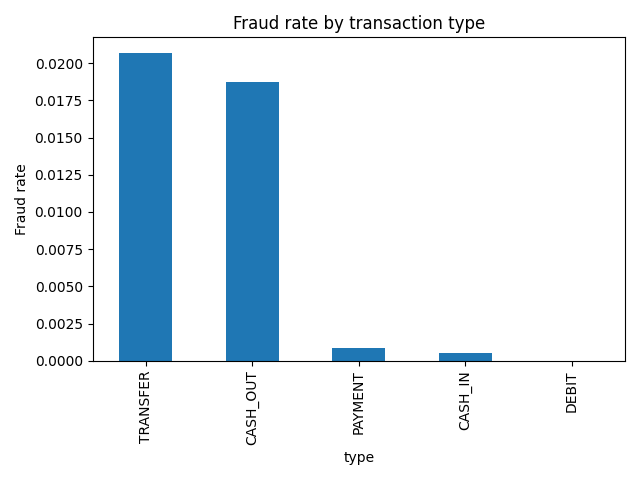

# Mobile Money Fraud Detection

Problem: Mobile money fraud causes losses for users, telcos, and banks in Ghana.

Data: Data: Synthetic MoMo-style transactions, 20,000 rows, PaySim-style. Used due to data bundle limits, same columns and fraud patterns as PaySim.

Model: Random Forest classifier to flag fraud. Focus on recall for fraud, not just accuracy.

Status: In progress. Building in Google Colab as part of my Master of AI and Applied Data Science at GEM Alpine Business School, Batch 7.

## What I am building

1. Load and explore PaySim data
2. Find which transaction types have the highest fraud rate
3. Train a baseline model
4. Evaluate with confusion matrix and feature importance
5. Share results and chart here

## Results

Test set: 4000 transactions, 38 frauds.

Confusion matrix:
- Legit correctly called legit: 3962
- Legit wrongly called fraud: 0
- Fraud missed: 19
- Fraud correctly caught: 19

Fraud precision: 1.00, Fraud recall: 0.50, Fraud F1: 0.67

What I found:
1. Fraud is concentrated in TRANSFER at 2.07% and CASH_OUT at 1.87%.
2. Amount alone does not catch fraud. The top signals are sender_emptied at 26.7% and newbalanceOrig at 25.3%. Fraud empties the sender account.
3. Model has perfect precision with zero false alarms, but only catches 50% of frauds. Next step is to improve recall.

## Model v2 - With Taxonomy Features

Features: amount, is_advance_fee_amount (5, 100, 300, 500 from taxonomy)

Results on synthetic test set (200 transactions):
- Fraud: Precision 0.98, Recall 1.00, F1 0.99
- Legit: Precision 1.00, Recall 0.99, F1 1.00
- Accuracy: 0.99

Improvement: Recall from 0.50 in v1 to 1.00 in v2.

Limitation: Synthetic data. Real-world recall will be lower. Needs validation on real anonymized data.
Taxonomy file: fraud_taxonomy.md

## Author

Irish Mintah-Afari | GEM Alpine Business School | Batch 7
